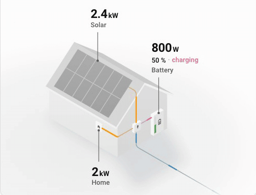
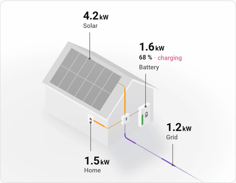
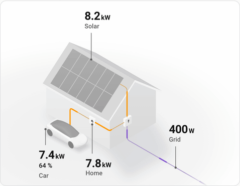

# Flixlix Cards

This is a monorepo for all my Home Assistant cards, including their source code, release management, and documentation.

> [!TIP]
> **Canonical documentation: [cards.flixlix.com](https://cards.flixlix.com).** Installation, the full configuration reference, copy-paste examples and a live playground for every card. The per-card GitHub repos are distribution copies; this repository and the docs site are the source.

## Cards

- **[Power Flow Card Plus](https://cards.flixlix.com/power-flow-card-plus)** — live solar, battery and grid power on a Lovelace dashboard. [README](packages/flixlix-cards/power-flow-card-plus/README.md)
- **[Home Flow Card](https://cards.flixlix.com/home-flow-card)** — the same live power as an isometric house. [README](packages/flixlix-cards/home-flow-card/README.md)
- **[Energy Flow Card Plus](https://cards.flixlix.com/energy-flow-card-plus)** — solar, battery and grid energy over a day, week or year. [README](packages/flixlix-cards/energy-flow-card-plus/README.md)
- **[Energy Breakdown Card](https://cards.flixlix.com/energy-breakdown-card)** — a donut or bar of where that energy went. [README](packages/flixlix-cards/energy-breakdown-card/README.md)
- **[Energy Period Selector Plus](https://cards.flixlix.com/energy-period-selector-plus)** — a custom energy date picker for those cards. [README](packages/flixlix-cards/energy-period-selector-plus/README.md)
- **[Sortable List Card](https://cards.flixlix.com/sortable-list-card)** — a drag-to-reorder list, including a HEMS load-priority list. [README](packages/flixlix-cards/sortable-list-card/README.md)

Guides on the docs site: [solar and battery power flow](https://cards.flixlix.com/guides/solar-battery-power-flow), [which card to use](https://cards.flixlix.com/guides), [vs the original Power Flow Card](https://cards.flixlix.com/guides/power-flow-card-plus-vs-power-flow-card), [vs Sunsynk](https://cards.flixlix.com/guides/power-flow-card-plus-vs-sunsynk), [vs Tesla Style](https://cards.flixlix.com/guides/power-flow-card-plus-vs-tesla-style), [Energy Distribution alternative](https://cards.flixlix.com/guides/energy-distribution-card-alternative).

### Home Flow Card

Your own little isometric home, with your live power flowing through it. [Try it live in the playground](https://cards.flixlix.com/home-flow-card/playground), no install needed.

  
  

### Power Flow Card Plus, Energy Flow Card Plus and Energy Breakdown Card

## Issues and Feature Requests

Have feedback, feature ideas, or encountered a problem? We encourage you to open an issue in this repository.
When submitting, simply select the relevant card so I can assist you more efficiently.
[Open an issue](https://github.com/flixlix/flixlix-cards/issues/new/choose)

## Contributing

Contributions are welcome! Check out the [CONTRIBUTING.md](CONTRIBUTING.md) file for more information, or read the [How to contribute](https://cards.flixlix.com/contributing) guide on the docs site.

## License

This project is released under the [MIT License](LICENSE). You are free to use, fork, modify, and redistribute the cards, including through HACS.
