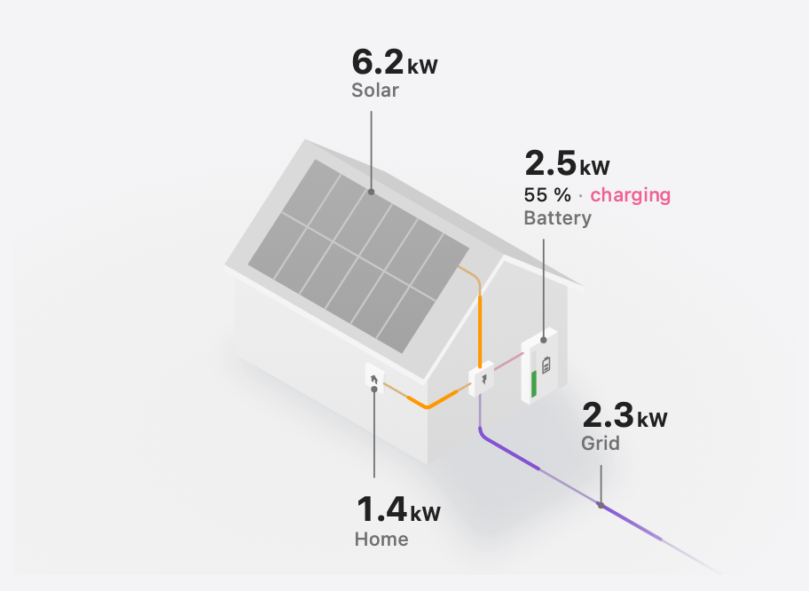

# Home Flow Card




Your power flows drawn on an isometric house: solar panels on the roof, a battery on the wall and
every wire running through the inverter, with each value next to what it measures. It reads the
same sensors as [Power Flow Card Plus](https://github.com/flixlix/power-flow-card-plus), and its
`grid`, `solar`, `battery` and `home` take the same options, at the top level of the card.

📖 Full documentation: [cards.flixlix.com/home-flow-card](https://cards.flixlix.com/home-flow-card)

## Features

- Solar on the roof, a battery on the wall, the grid cable to the street; only what you configure is drawn
- A pulse runs along each wire in the direction its power flows, faster and longer the more power it carries
- Numbers roll to their new value when a reading changes (`animate_numbers`)
- The battery's icon follows its state of charge, as in Power Flow Card Plus; its charge bar turns yellow and red at thresholds you set
- Under the battery's value: its state of charge and whether it is charging or discharging
- The grid has no label: its cable carries the flow. During an outage it goes dead, and an optional generator, wired to the inverter (never to the grid cable), takes over
- Greys taken from your theme, in light and dark
- Visual editor

Individual devices are not drawn yet; use Power Flow Card Plus for those.

## Installation

Add `https://github.com/flixlix/home-flow-card` as a custom repository (category
**Dashboard**) in HACS and download **Home Flow Card**. To install manually, copy
`home-flow-card.js` from the latest release into `config/www/` and add it as a dashboard
resource (`/local/home-flow-card.js`, type `module`).

## Configuration

| Name                               | Type    | Default                   | Description                                                                                                                                         |
| ---------------------------------- | ------- | ------------------------- | --------------------------------------------------------------------------------------------------------------------------------------------------- |
| `type`                             | string  | —                         | `custom:home-flow-card`                                                                                                                             |
| `grid`, `solar`, `battery`, `home` | object  | —                         | Each node, configured as in [Power Flow Card Plus](https://cards.flixlix.com/power-flow-card-plus/configuration); leave one out and it is not drawn |
| `title`                            | string  | —                         | Card title                                                                                                                                          |
| `animate_numbers`                  | boolean | `true`                    | Roll each number to its new value when a reading changes. Always still when your system asks for reduced motion                                     |
| `clickable_entities`               | boolean | `false`                   | Tapping a value opens its entity, or runs the node's tap/hold actions                                                                               |
| `disable_dots`                     | boolean | `false`                   | Keep the wires still: no pulses, only the colour of the power they carry                                                                            |
| `battery.state_of_charge_severity` | object  | `{ red: 15, yellow: 30 }` | Battery charge bar colours, in %: red below `red`, yellow below `yellow`, green above both                                                          |
| `generator`                        | object  | —                         | `entity` (and optional `name`) of a generator the inverter switches to during a grid outage; needs `grid.power_outage`                              |
| `base_decimals`                    | number  | `0`                       | Decimals of values in W                                                                                                                             |
| `kilo_decimals`                    | number  | `1`                       | Decimals of values in kW                                                                                                                            |
| `kilo_threshold`                   | number  | `1000`                    | From how many watts a value is shown in kW                                                                                                          |
| `min_flow_rate`                    | number  | `0.75`                    | Seconds per pulse at the most power                                                                                                                 |
| `max_flow_rate`                    | number  | `6`                       | Seconds per pulse at the least power                                                                                                                |
| `max_expected_power`               | number  | `2000`                    | Power at which pulses run their fastest                                                                                                             |

Coming from Power Flow Card Plus? Move `grid`, `solar`, `battery` and `home` out of `entities` to the
top level. Options that only change its circles and lines (for example `display_zero_lines`) have no
effect here.

## Examples

```yaml
type: custom:home-flow-card
grid:
  entity: sensor.grid_power
solar:
  entity: sensor.solar_power
battery:
  entity: sensor.battery_power
  state_of_charge: sensor.battery_soc
```

```yaml
type: custom:home-flow-card
animate_numbers: false
grid:
  entity:
    consumption: sensor.grid_import_power
    production: sensor.grid_export_power
  power_outage:
    entity: binary_sensor.grid_outage
generator:
  entity: sensor.generator_power
solar:
  entity: sensor.solar_power
battery:
  entity: sensor.battery_power
  state_of_charge: sensor.battery_soc
  state_of_charge_severity:
    red: 10
    yellow: 25
```
