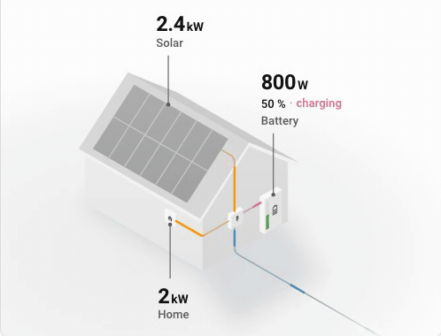
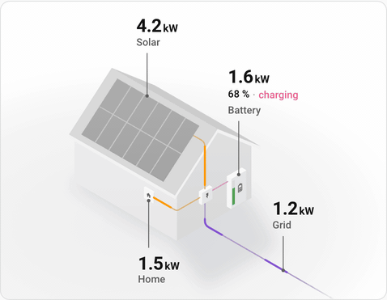
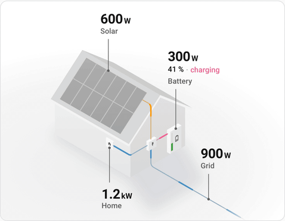
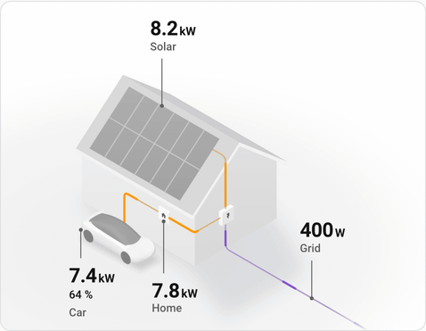
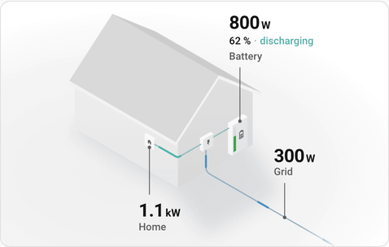
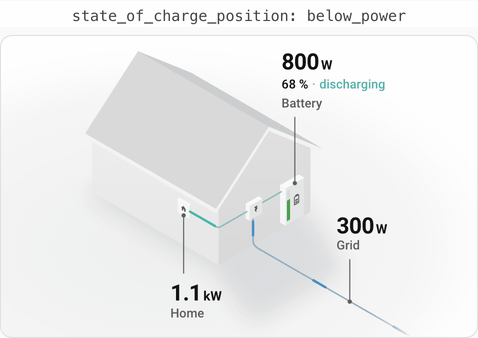
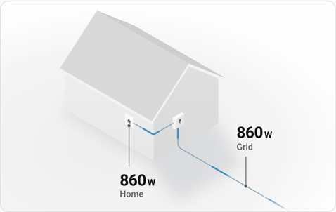
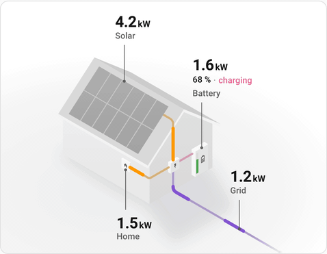
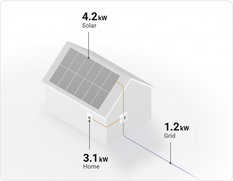

# Home Flow Card

[](https://ko-fi.com/flixlix)
[](https://github.com/hacs/integration)


**Your own little isometric home in Home Assistant, with your live power, or your day's energy, flowing through it.**



Solar sits on the roof, the battery on the wall and the grid runs off to the street, every wire
meeting at the inverter. One look tells you where your power comes from and where it goes.

> [!TIP]
> 📖 **[Documentation](https://cards.flixlix.com/home-flow-card)** · 🎮 **[Try it live in the playground](https://cards.flixlix.com/home-flow-card/playground)**, no install needed

## Why a house?

- **Reads at a glance.** You know where your power comes from before you read a single number.
- **Motion that means something.** A pulse runs along every wire in the direction its power flows,
  faster and longer the more it carries. Numbers roll to their new value, units slide along, and
  "Charging" becomes "Discharging" by changing only the letters that differ.
- **Made for your dashboard.** Monotone greys from your theme, light and dark, with colour only where
  power flows. It scales to any card width, and the visual editor sets it up without YAML.
- **Ready for the bad days.** When the grid fails, its cable goes dead and its label says so. An
  optional generator appears, wired to the inverter and never to the grid, and its label takes the
  grid's place. A nearly empty battery turns its charge bar yellow, then red, at thresholds you
  choose.
- **Your car, too.** An optional electric car parks in front of the house, wired to the home's
  outlet, with its power and state of charge on its label. Unplugged it waits faded,
  without its cable; away, it is not drawn at all, on conditions you choose.
- **And your heat pump.** An optional heat pump hangs on the front wall, wired to the home's
  outlet, its fan turning while it runs. Its label shows its power and what it is doing, or its
  temperature, and a tap opens its thermostat.

Only what you configure is drawn: solar alone, a battery and the grid, or the whole house.
Individual devices are not drawn yet; use [Power Flow Card Plus](https://github.com/flixlix/power-flow-card-plus)
for those.

## Installation

[](https://my.home-assistant.io/redirect/hacs_repository/?owner=flixlix&repository=home-flow-card&category=plugin)

This card is in the default catalog. On Home Assistant 2026.11 and newer, go to
**Settings → Marketplace**, search for **Home Flow Card** and install it. Before 2026.11, search for
it in [HACS](https://hacs.xyz) and download it.

To install manually, copy `home-flow-card.js` from the
[latest release](https://github.com/flixlix/home-flow-card/releases/latest) into `config/www/` and
add it as a dashboard resource (`/local/home-flow-card.js`, type `module`).

## Set up in a minute

Point it at the sensors you already have; leave one out and the house doesn't draw it.

```yaml
type: custom:home-flow-card
grid:
  entity: sensor.grid_power
solar:
  entity: sensor.solar_power
battery:
  entity: sensor.battery_power
  state_of_charge: sensor.battery_soc
```

**Already using Power Flow Card Plus?** Home Flow Card reads the same sensors and its nodes take the
same options. Change the `type` and move `grid`, `solar`, `battery` and `home` out of `entities` to
the top level. Options that only change Power Flow Card Plus' circles and lines (for example
`display_zero_lines`) have no effect here.

## Configuration

Every option the card reads, by where it goes in the YAML. Only `type` and one of `grid`, `solar`
or `battery` are required.

### Card options

| Name                 | Type    | Default   | Description                                                                                                                                                                                                                     |
| -------------------- | ------- | --------- | ------------------------------------------------------------------------------------------------------------------------------------------------------------------------------------------------------------------------------- |
| `type`               | string  | -         | `custom:home-flow-card`                                                                                                                                                                                                         |
| `title`              | string  | -         | Card title                                                                                                                                                                                                                      |
| `mode`               | string  | `power`   | What the sensors measure: `power` for live power, or `energy` for energy over the period picked on the dashboard's energy date picker (today without one). See [Energy over the day](#energy-over-the-day)                      |
| `collection_key`     | string  | -         | With `mode: energy`, the energy date picker to follow, as in Energy Flow Card Plus, for example `energy_living_room`. Without it, the dashboard's own                                                                           |
| `energy_entities`    | object  | -         | Each node's energy sensor, for a selector in the card's corner between live power and today. See [Live power or the day so far](#live-power-or-the-day-so-far)                                                                  |
| `grid`               | object  | -         | The grid, see [Grid](#grid)                                                                                                                                                                                                     |
| `solar`              | object  | -         | Solar on the roof, see [Solar](#solar)                                                                                                                                                                                          |
| `battery`            | object  | -         | The battery on the wall, see [Battery](#battery)                                                                                                                                                                                |
| `home`               | object  | -         | The home's consumption, see [Home](#home). Without it, the card works out what the home uses from the others                                                                                                                    |
| `generator`          | object  | -         | A generator for grid outages, see [Generator](#generator)                                                                                                                                                                       |
| `car`                | object  | -         | An electric car in front of the house, see [Car](#car)                                                                                                                                                                          |
| `heat_pump`          | object  | -         | A heat pump on the front wall, see [Heat pump](#heat-pump)                                                                                                                                                                      |
| `animate_numbers`    | boolean | `true`    | Roll each number to its new value when a reading changes. Always still when your system asks for reduced motion                                                                                                                 |
| `disable_dots`       | boolean | `false`   | Keep the wires still: no pulses, only the colour of the power they carry                                                                                                                                                        |
| `wire_width`         | number  | `1`       | How many times thicker the wires are drawn, for example `2` for twice as thick. Like the labels, they keep a similar size whatever the card's width                                                                             |
| `two_way_value_size` | number  | `1`       | In energy mode, how large the values of a grid or battery that ran both ways are drawn against the other labels' values, for example `0.8` so their two values take less room                                                   |
| `clickable_entities` | boolean | `true`    | Tapping a value opens its entity's details; `false` turns that off. A node's own actions run either way                                                                                                                         |
| `base_decimals`      | number  | `0`       | Decimals of values in W (Wh in energy mode)                                                                                                                                                                                     |
| `kilo_decimals`      | number  | `1`       | Decimals of values in kW (kWh)                                                                                                                                                                                                  |
| `kilo_threshold`     | number  | `1000`    | From how many W (Wh) a value is shown in kW (kWh)                                                                                                                                                                               |
| `mega_decimals`      | number  | `2`       | Decimals of values in MW (MWh)                                                                                                                                                                                                  |
| `mega_threshold`     | number  | `1000000` | From how many W (Wh) a value is shown in MW (MWh)                                                                                                                                                                               |
| `min_flow_rate`      | number  | `0.75`    | Seconds per pulse at the most power                                                                                                                                                                                             |
| `max_flow_rate`      | number  | `6`       | Seconds per pulse at the least power                                                                                                                                                                                            |
| `min_expected_value` | number  | `0.01`    | Where pulses run their slowest and shortest, in W (Wh in energy mode). In energy mode without an expected range, each wire's pulses share out what was supplied. Replaces `min_expected_power`, which still works in power mode |
| `max_expected_value` | number  | `2000`    | Where pulses run their fastest and longest, in W (Wh in energy mode). Replaces `max_expected_power`, which still works in power mode                                                                                            |

Leave a node out and the house does not draw it. `grid`, `solar`, `battery` and `home` take the
same options as in [Power Flow Card Plus](https://cards.flixlix.com/power-flow-card-plus/configuration);
the tables below list the ones that change the house.

### Grid

| Name                       | Type             | Default        | Description                                                                                                                                                |
| -------------------------- | ---------------- | -------------- | ---------------------------------------------------------------------------------------------------------------------------------------------------------- |
| `entity`                   | string or object | -              | **Required.** A power or energy sensor, positive while importing and negative while exporting, or `consumption` and `production`, one sensor per direction |
| `entity.consumption`       | string           | -              | The import sensor, positive while importing                                                                                                                |
| `entity.production`        | string           | -              | The export sensor, positive while exporting                                                                                                                |
| `name`                     | string           | `Grid`         | Label name                                                                                                                                                 |
| `power_outage`             | object           | -              | Tells the card when the grid is down: its cable goes dead and its label shows an alert. Live only: energy mode leaves it out                               |
| `power_outage.entity`      | string           | -              | **Required** with `power_outage`. The entity that reports an outage                                                                                        |
| `power_outage.state_alert` | string           | `on`           | The state of `power_outage.entity` that means the grid is down                                                                                             |
| `power_outage.label_alert` | string           | `Power Outage` | The alert under the grid's name during an outage                                                                                                           |
| `invert_state`             | boolean          | `false`        | Swap import and export, for a sensor that reads the other way round                                                                                        |
| `use_metadata`             | boolean          | `false`        | Take the name from the entity                                                                                                                              |
| `display_zero_tolerance`   | number           | `0`            | Below this, in W (Wh in energy mode), the grid counts as idle                                                                                              |
| `unit_of_measurement`      | string           | -              | Unit shown instead of the sensor's own                                                                                                                     |
| `decimals`                 | number           | -              | Decimals of the value, instead of the card's `base_decimals` and `kilo_decimals`                                                                           |
| `color.consumption`        | string or list   | theme          | Colour of the wire while importing, as `#rrggbb` or `[r, g, b]`                                                                                            |
| `color.production`         | string or list   | theme          | Colour of the wire while exporting                                                                                                                         |
| `tap_action`               | object           | -              | What tapping the label does, see [Actions](#actions)                                                                                                       |
| `hold_action`              | object           | -              | What holding the label does                                                                                                                                |
| `double_tap_action`        | object           | -              | What double-tapping the label does                                                                                                                         |

### Solar

| Name                     | Type           | Default | Description                                          |
| ------------------------ | -------------- | ------- | ---------------------------------------------------- |
| `entity`                 | string         | -       | **Required.** The solar production sensor            |
| `name`                   | string         | `Solar` | Label name                                           |
| `invert_state`           | boolean        | `false` | For a sensor that reads production as negative       |
| `use_metadata`           | boolean        | `false` | Take the name from the entity                        |
| `display_zero_tolerance` | number         | `0`     | Below this, in W (Wh), solar counts as idle          |
| `unit_of_measurement`    | string         | -       | Unit shown instead of the sensor's own               |
| `decimals`               | number         | -       | Decimals of the value, instead of the card's         |
| `color`                  | string or list | theme   | Colour of the wire, as `#rrggbb` or `[r, g, b]`      |
| `tap_action`             | object         | -       | What tapping the label does, see [Actions](#actions) |
| `hold_action`            | object         | -       | What holding the label does                          |
| `double_tap_action`      | object         | -       | What double-tapping the label does                   |

### Battery

| Name                               | Type             | Default       | Description                                                                                                                                                                                                                     |
| ---------------------------------- | ---------------- | ------------- | ------------------------------------------------------------------------------------------------------------------------------------------------------------------------------------------------------------------------------- |
| `entity`                           | string or object | -             | **Required.** A power or energy sensor, positive while discharging and negative while charging, or `consumption` and `production`, one per direction                                                                            |
| `entity.consumption`               | string           | -             | The discharge sensor, positive while discharging                                                                                                                                                                                |
| `entity.production`                | string           | -             | The charge sensor, positive while charging                                                                                                                                                                                      |
| `state_of_charge`                  | string           | -             | The state of charge sensor, in %. Fills the charge bar and shows on the label                                                                                                                                                   |
| `state_of_charge_position`         | string           | `below_value` | Where the label shows the state of charge: `below_value`, `above_value` (swapped with the value), `after_value` or `before_value` (inline). The older `below_power`, `above_power`, `after_power` and `before_power` still work |
| `state_of_charge_severity`         | object           | -             | Where the charge bar changes colour, in %                                                                                                                                                                                       |
| `state_of_charge_severity.red`     | number           | `15`          | The bar is red below this charge                                                                                                                                                                                                |
| `state_of_charge_severity.yellow`  | number           | `30`          | The bar is yellow below this charge, and green above it                                                                                                                                                                         |
| `state_of_charge_unit`             | string           | `%`           | Unit of the state of charge                                                                                                                                                                                                     |
| `state_of_charge_unit_white_space` | boolean          | `true`        | Put a space between the state of charge and its unit                                                                                                                                                                            |
| `state_of_charge_decimals`         | number           | `0`           | Decimals of the state of charge                                                                                                                                                                                                 |
| `name`                             | string           | `Battery`     | Label name                                                                                                                                                                                                                      |
| `icon`                             | string           | by charge     | The icon on the battery: `mdi:battery`, `mdi:battery-high`, `mdi:battery-medium`, `mdi:battery-low` or `mdi:battery-outline`. By default it follows the state of charge                                                         |
| `invert_state`                     | boolean          | `false`       | Swap charging and discharging, for a sensor that reads the other way round                                                                                                                                                      |
| `use_metadata`                     | boolean          | `false`       | Take the name and icon from the entity                                                                                                                                                                                          |
| `display_zero_tolerance`           | number           | `0`           | Below this, in W (Wh), the battery counts as idle                                                                                                                                                                               |
| `unit_of_measurement`              | string           | -             | Unit shown instead of the sensor's own                                                                                                                                                                                          |
| `decimals`                         | number           | -             | Decimals of the value, instead of the card's                                                                                                                                                                                    |
| `color.consumption`                | string or list   | theme         | Colour of the wire while discharging, as `#rrggbb` or `[r, g, b]`                                                                                                                                                               |
| `color.production`                 | string or list   | theme         | Colour of the wire while charging                                                                                                                                                                                               |
| `tap_action`                       | object           | -             | What tapping the label does, see [Actions](#actions)                                                                                                                                                                            |
| `hold_action`                      | object           | -             | What holding the label does                                                                                                                                                                                                     |
| `double_tap_action`                | object           | -             | What double-tapping the label does                                                                                                                                                                                              |

### Home

Without a `home`, the card works out what the home uses from the other nodes.

| Name                  | Type    | Default | Description                                                                      |
| --------------------- | ------- | ------- | -------------------------------------------------------------------------------- |
| `entity`              | string  | -       | The home's consumption sensor, opened on tap and read with `override_state`      |
| `name`                | string  | `Home`  | Label name                                                                       |
| `override_state`      | boolean | `false` | Show the `entity`'s reading instead of the home's consumption the card works out |
| `use_metadata`        | boolean | `false` | Take the name from the entity                                                    |
| `unit_of_measurement` | string  | -       | Unit shown instead of the sensor's own                                           |
| `decimals`            | number  | -       | Decimals of the value, instead of the card's                                     |
| `tap_action`          | object  | -       | What tapping the label does, see [Actions](#actions)                             |
| `hold_action`         | object  | -       | What holding the label does                                                      |
| `double_tap_action`   | object  | -       | What double-tapping the label does                                               |

### Generator

A generator the inverter switches to during a grid outage. It gets its own wire into the inverter
and is never drawn on the grid cable. It needs [`grid.power_outage`](#grid) to know when the grid
is down; while it runs, its label takes the grid's place. In energy mode it needs no
`power_outage`: it shows beside the grid whenever it ran over the period, and the grid's label
moves under its cable.

| Name     | Type   | Default     | Description                                          |
| -------- | ------ | ----------- | ---------------------------------------------------- |
| `entity` | string | -           | **Required.** The generator's power or energy sensor |
| `name`   | string | `Generator` | Label name                                           |

### Car

An electric car parked in front of the house, wired to the home's outlet. Idle without a
`state_of_charge`, it is drawn on its own, without a label.

| Name              | Type   | Default | Description                                                                                                                                                                                                                         |
| ----------------- | ------ | ------- | ----------------------------------------------------------------------------------------------------------------------------------------------------------------------------------------------------------------------------------- |
| `entity`          | string | -       | **Required.** Its charging power or energy, positive while it charges and negative while it feeds the home                                                                                                                          |
| `state_of_charge` | string | -       | Its battery level, in %, shown on its label under its power                                                                                                                                                                         |
| `name`            | string | `Car`   | Label name                                                                                                                                                                                                                          |
| `visibility`      | list   | -       | [Conditions](#conditions): the car shows only while all of them hold. While hidden it keeps its room, so the house does not move. Without, it always shows                                                                          |
| `idle`            | list   | -       | [Conditions](#conditions): while all of them hold, the car is drawn faded and unplugged, without its cable. Without, it is idle while it draws no power. Live only: in energy mode it is idle while it used nothing over the period |

### Heat pump

A heat pump on the front wall, wired to the home's outlet. With a `car` configured it hangs above
where the car parks; without one, low and further along the wall, its label below it. Only the config decides, so it stays put while
the car is away.

| Name      | Type   | Default     | Description                                                                                                                                                     |
| --------- | ------ | ----------- | --------------------------------------------------------------------------------------------------------------------------------------------------------------- |
| `entity`  | string | -           | **Required.** Its power or energy                                                                                                                               |
| `climate` | string | -           | Its climate entity: a tap on its label opens it, and its label reads its state or temperature from it. Without it, a tap opens `entity`                         |
| `status`  | string | `state`     | What its label shows under its power, read from `climate`: `state` (what it is doing, e.g. Heating), `temperature`, or `temperature_and_target` (38 °C → 45 °C) |
| `name`    | string | `Heat pump` | Label name                                                                                                                                                      |

#### Conditions

`car.visibility` and `car.idle` take the conditions of a card's visibility tab, and the editor sets
them up the same way:

| `condition`     | Options                                              |
| --------------- | ---------------------------------------------------- |
| `state`         | `entity`, `state` or `state_not` (a value or a list) |
| `numeric_state` | `entity`, `above`, `below`                           |
| `screen`        | `media_query`                                        |
| `user`          | `users` (user ids)                                   |
| `time`          | `after`, `before`, `weekdays`                        |
| `location`      | `locations` (`home`, `not_home` or zones)            |
| `and`, `or`     | `conditions`                                         |
| `not`           | `conditions`, passes unless all of them hold         |

Template, sun, zone and device conditions need Home Assistant itself and are ignored.

### Actions

`tap_action`, `hold_action` and `double_tap_action` take Home Assistant's
[actions](https://www.home-assistant.io/dashboards/actions/): `more-info`, `toggle`, `navigate`,
`url`, `perform-action`, `assist` or `none`. Without any of them, tapping a label opens its
entity's details, unless `clickable_entities: false`.

## Examples

Each recorded from the real card.

### Solar and a battery

The full house: solar, a battery with its state of charge, and the grid.



```yaml
type: custom:home-flow-card
grid:
  entity: sensor.grid_power
solar:
  entity: sensor.solar_power
battery:
  entity: sensor.battery_power
  state_of_charge: sensor.battery_soc
```

### Separate sensors, an outage and a generator

One sensor per direction, the grid's outage sensor, and a generator that steps in when the grid
goes down.



```yaml
type: custom:home-flow-card
grid:
  entity:
    consumption: sensor.grid_import_power
    production: sensor.grid_export_power
  power_outage:
    entity: binary_sensor.grid_outage
generator:
  entity: sensor.generator_power
solar:
  entity: sensor.solar_power
battery:
  entity:
    consumption: sensor.battery_discharge_power
    production: sensor.battery_charge_power
  state_of_charge: sensor.battery_soc
```

### A car charging off the sun

The car shows only while it is home, and waits faded and unplugged while its cable is out.



```yaml
type: custom:home-flow-card
grid:
  entity: sensor.grid_power
solar:
  entity: sensor.solar_power
car:
  entity: sensor.wallbox_power
  state_of_charge: sensor.car_battery_level
  visibility:
    - condition: state
      entity: device_tracker.car
      state: home
  idle:
    - condition: state
      entity: binary_sensor.car_plugged_in
      state: "off"
```

### A heat pump heating towards its target

```yaml
type: custom:home-flow-card
grid:
  entity: sensor.grid_power
solar:
  entity: sensor.solar_power
heat_pump:
  entity: sensor.heat_pump_power
  climate: climate.heat_pump
  status: temperature_and_target
```

### Energy over the day

With `mode: energy`, the same house shows what each node made, stored, bought or used over the
period picked on the dashboard's energy date picker. Point every node, the car and the heat pump at
energy sensors (kWh), the ones Home Assistant's energy dashboard uses. Each wire carries its energy
over the period, and its pulses share out what was supplied, unless `min_expected_value` or
`max_expected_value` set a range in Wh. When the grid or the battery ran both
ways, it gets two parallel lines, one each way, and its label shows both values in their colours.

The battery's and the car's state of charge stay live. What only says what is happening right now
is left out: the battery's "Charging" and "Discharging", the grid's outage, the car's `idle`
conditions and the heat pump's turning fan. Thresholds such as `display_zero_tolerance` and
`kilo_threshold` are in Wh.

```yaml
type: custom:home-flow-card
mode: energy
grid:
  entity:
    consumption: sensor.grid_import_energy
    production: sensor.grid_export_energy
solar:
  entity: sensor.solar_energy
battery:
  entity:
    consumption: sensor.battery_discharge_energy
    production: sensor.battery_charge_energy
  state_of_charge: sensor.battery_soc
```

### Live power or the day so far

Give the nodes their energy sensors too, under `energy_entities`, and the card gets a selector in
its top right corner between live power and today's energy. The card reads today itself rather than
follow a date picker. Each node keeps its name, colours and state of charge; only its sensor
changes. The house keeps the size and place it has for live power, so only the selector is added. A
node without an energy sensor is left out of today, and the home without one shows what flowed into
it. With `mode: energy`, the card opens on today.

```yaml
type: custom:home-flow-card
grid:
  entity: sensor.grid_power
solar:
  entity: sensor.solar_power
battery:
  entity: sensor.battery_power
  state_of_charge: sensor.battery_soc
energy_entities:
  grid:
    consumption: sensor.grid_import_energy
    production: sensor.grid_export_energy
  solar: sensor.solar_energy
  battery:
    consumption: sensor.battery_discharge_energy
    production: sensor.battery_charge_energy
```

### Your own battery thresholds

Turn the charge bar yellow and red where it matters for your battery.



```yaml
type: custom:home-flow-card
grid:
  entity: sensor.grid_power
battery:
  entity: sensor.battery_power
  state_of_charge: sensor.battery_soc
  state_of_charge_severity:
    red: 25
    yellow: 50
```

### Where the state of charge sits

Under the value, swapped with it, or on its line.



```yaml
type: custom:home-flow-card
grid:
  entity: sensor.grid_power
battery:
  entity: sensor.battery_power
  state_of_charge: sensor.battery_soc
  state_of_charge_position: after_value
```

### Grid only

Without solar or a battery, the house shows the grid feeding the home.



```yaml
type: custom:home-flow-card
grid:
  entity: sensor.grid_power
```

### Thicker wires

Draw the wires twice as thick. They keep that size whatever the card's width.



```yaml
type: custom:home-flow-card
wire_width: 2
grid:
  entity: sensor.grid_power
solar:
  entity: sensor.solar_power
battery:
  entity: sensor.battery_power
  state_of_charge: sensor.battery_soc
```

### Still numbers and wires

Plain numbers and no pulses, for a calmer dashboard.



```yaml
type: custom:home-flow-card
animate_numbers: false
disable_dots: true
grid:
  entity: sensor.grid_power
solar:
  entity: sensor.solar_power
```

## Source and issues

This card is distributed via [flixlix/home-flow-card](https://github.com/flixlix/home-flow-card);
the source lives in the monorepo [flixlix/flixlix-cards](https://github.com/flixlix/flixlix-cards),
where issues and feature requests are tracked.
