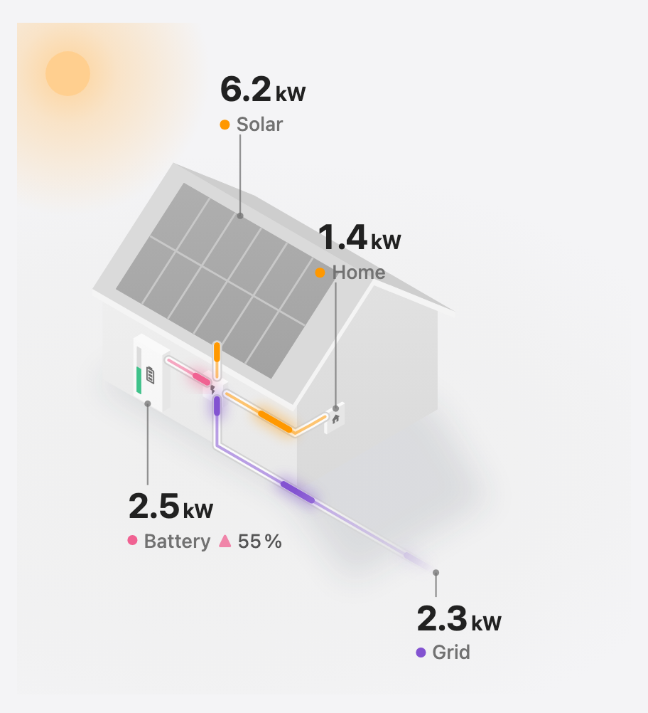

# Power Flow House Card




Your power flows drawn on an isometric house: solar panels on the roof, a battery on the wall and
every wire running through the inverter, with each value next to what it measures. It reads the
same sensors as [Power Flow Card Plus](https://github.com/flixlix/power-flow-card-plus) and takes
the same `entities` config, so you can try it by changing the card's `type`.

📖 Full documentation: [cards.flixlix.com/power-flow-house-card](https://cards.flixlix.com/power-flow-house-card)

## Features

- Solar on the roof, a battery on the wall, the grid cable to the street; only what you configure is drawn
- A pulse runs along each wire in the direction its power flows, faster the more power it carries
- Numbers roll to their new value when a reading changes (`animate_numbers`)
- Battery state of charge, and whether it is charging (▲) or discharging (▼)
- The low-carbon share and power outages on the grid
- Greys taken from your theme, in light and dark
- Visual editor

Individual devices are not drawn yet; use Power Flow Card Plus for those.

## Installation

Add `https://github.com/flixlix/power-flow-house-card` as a custom repository (category
**Dashboard**) in HACS and download **Power Flow House Card**. To install manually, copy
`power-flow-house-card.js` from the latest release into `config/www/` and add it as a dashboard
resource (`/local/power-flow-house-card.js`, type `module`).

## Configuration

| Name                 | Type    | Default | Description                                                                                                                                                 |
| -------------------- | ------- | ------- | ----------------------------------------------------------------------------------------------------------------------------------------------------------- |
| `type`               | string  | —       | `custom:power-flow-house-card`                                                                                                                              |
| `entities`           | object  | —       | `grid`, `solar`, `battery`, `home` and `fossil_fuel_percentage`, as in [Power Flow Card Plus](https://cards.flixlix.com/power-flow-card-plus/configuration) |
| `title`              | string  | —       | Card title                                                                                                                                                  |
| `animate_numbers`    | boolean | `true`  | Roll each number to its new value when a reading changes. Always still when your system asks for reduced motion                                             |
| `clickable_entities` | boolean | `false` | Tapping a value opens its entity, or runs the node's tap/hold actions                                                                                       |
| `disable_dots`       | boolean | `false` | Keep the wires still: no pulses, only the colour of the power they carry                                                                                    |
| `base_decimals`      | number  | `0`     | Decimals of values in W                                                                                                                                     |
| `kilo_decimals`      | number  | `1`     | Decimals of values in kW                                                                                                                                    |
| `kilo_threshold`     | number  | `1000`  | From how many watts a value is shown in kW                                                                                                                  |
| `min_flow_rate`      | number  | `0.75`  | Seconds per pulse at the most power                                                                                                                         |
| `max_flow_rate`      | number  | `6`     | Seconds per pulse at the least power                                                                                                                        |
| `max_expected_power` | number  | `2000`  | Power at which pulses run their fastest and the sun glows fully                                                                                             |

Options that only change Power Flow Card Plus' circles and lines (for example `display_zero_lines`)
have no effect here.

## Examples

```yaml
type: custom:power-flow-house-card
entities:
  grid:
    entity: sensor.grid_power
  solar:
    entity: sensor.solar_power
  battery:
    entity: sensor.battery_power
    state_of_charge: sensor.battery_soc
```

```yaml
type: custom:power-flow-house-card
animate_numbers: false
entities:
  grid:
    entity:
      consumption: sensor.grid_import_power
      production: sensor.grid_export_power
    power_outage:
      entity: binary_sensor.grid_outage
  solar:
    entity: sensor.solar_power
  fossil_fuel_percentage:
    entity: sensor.grid_fossil_fuel_percentage
    state_type: percentage
```
